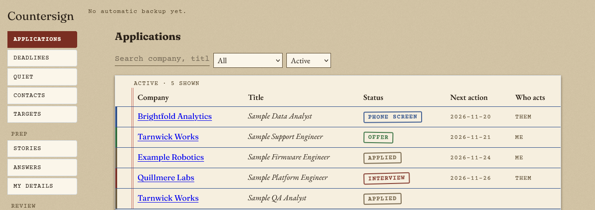

# Countersign

A local-only Firefox extension that records your job applications, what you sent each company, and the answers you give again and again.

[](https://github.com/firegiant9000/CounterSign/actions/workflows/ci.yml)

## The three claims

- **Local only.** All data stays on your machine. The extension makes no network requests.
- **Nothing runs until you click.** It has no content scripts and no access to web pages. The toolbar button opens its own dashboard tab.
- **It never submits anything.** It does not fill forms, apply for jobs or send data anywhere.

## How the claims are enforced

Each claim is checked by the gate (`npm run gate`), which CI also runs.

| Claim                        | How it is enforced                                                                                                                                                                                                                                                                                                                                                                                                                                                                                                                                                                                   |
| ---------------------------- | ---------------------------------------------------------------------------------------------------------------------------------------------------------------------------------------------------------------------------------------------------------------------------------------------------------------------------------------------------------------------------------------------------------------------------------------------------------------------------------------------------------------------------------------------------------------------------------------------------- |
| Local only                   | [`guard/build.test.ts`](guard/build.test.ts) scans every built `.js` and `.html` file for network APIs (`fetch`, `XMLHttpRequest`, `WebSocket`, `EventSource`, `sendBeacon`, `WebTransport`, `RTCPeerConnection`), checks that no built page loads a remote `src` or `href`, and asserts the manifest has no host permissions. [`eslint.config.js`](eslint.config.js) bans the same APIs in source (`no-restricted-globals`, `no-restricted-properties`, `no-restricted-syntax`). The Content Security Policy in [`wxt.config.ts`](wxt.config.ts) sets `default-src 'self'; ... connect-src 'none'`. |
| Nothing runs until you click | [`guard/build.test.ts`](guard/build.test.ts) asserts the built manifest declares no content scripts and no web-accessible resources,. The stage 1 permissions are listed below. The background event page only registers a toolbar-click listener ([`entrypoints/background.ts`](entrypoints/background.ts)).                                                                                                                                                                                                                                                                                        |
| It never submits anything    | There is no code path that sends a request (see the first row), the manifest has no host access, and the CSP sets `form-action 'none'`, so a form on an extension page cannot post anywhere. The test asserts the exact CSP in the built manifest.                                                                                                                                                                                                                                                                                                                                                   |

Files are saved only through [`shell/files/download.ts`](shell/files/download.ts), which builds a local `blob:` URL. A lint rule in [`eslint.config.js`](eslint.config.js) rejects any other use of `downloads`, and [`guard/source-rules.test.ts`](guard/source-rules.test.ts) tests that rule.

<!-- Screenshot taken from the synthetic demo data (Data page, "Load demo data"). The image is added in Task 20. -->



## What it does today

Stage 1 is the dashboard. You enter everything by hand.

- **Applications list** with search, filters, manual entry, and a next-action date and who acts next.
- **Application detail** with a status history. Entries can be backdated, and a mistaken status can be undone without deleting history.
- **Resume and cover-letter records.** You attach a file to record which one you sent. Countersign stores the file name and a SHA-256 hash, not the file.
- **Canonical answers** (for example work authorisation or salary range), each with its history of earlier values.
- **Export and restore.** Export saves all data and settings to a JSON file. Restore checks the file first and saves a pre-restore copy of your current data (if there is any) before replacing it. A file that fails validation leaves your data untouched.
- **Demo data.** A synthetic data set so you can try it without typing in your own.

## What is next

- Stage 2: saving a job with a duplicate warning, automatic backup, "what I told them" with a mismatch warning, a quiet-application list, a deadlines view, simple contacts and a copy panel.
- Stage 3: follow-up tracking, an interview pack, a story bank, a weekly review and target companies.

Nothing in stages 2 and 3 exists yet. See the [design spec](docs/superpowers/specs/2026-11-13-countersign-design.md) for the plan.

## What it will never do

The tool has failed if it does any of these:

- Submit or auto-apply anything, or type into a page without a click.
- Send any data anywhere, including telemetry and error reports.
- Require an account or a server.
- Write application answers with AI, score "fit", or label a posting as fake or a ghost job.
- Show rejection tallies, streaks or other numbers that punish you by default.
- Force a tutorial, or inject overlays into pages.

## Permissions

These are the permissions the built manifest contains today. The build test enforces a ceiling (the `ALLOWED` list above), not this exact list. There is no `tabs` permission and no host access.

| Permission         | Why                                                                       |
| ------------------ | ------------------------------------------------------------------------- |
| `unlimitedStorage` | Keeps the IndexedDB database from being evicted or capped by the browser. |
| `storage`          | Saves settings (such as your status labels) in `storage.local`.           |
| `downloads`        | Saves export files and the pre-restore copy to your Downloads folder.     |

The toolbar button finds an already open dashboard tab with `runtime.getContexts`, which needs no `tabs` permission ([`shell/open-dashboard.ts`](shell/open-dashboard.ts)). The manifest also declares `data_collection_permissions` as `none`.

## Build and run

You need Node 22.20.0 (see `.nvmrc`) and Firefox.

```sh
npm ci
npm run dev
```

`npm run dev` starts the extension in Firefox. The dev build has no CSP, so check changes in the built extension too.

`npm run gate` runs lint, typecheck, unit tests, the build, the build tests and `web-ext lint`. To load a build by hand, run `npm run build`, open `about:debugging#/runtime/this-firefox`, choose "Load Temporary Add-on" and select `.output/firefox-mv3/manifest.json`.

The extension runs on Firefox 140 or later (`strict_min_version`). To run it from source, see [CONTRIBUTING.md](CONTRIBUTING.md).

## More

- [Design spec](docs/superpowers/specs/2026-11-13-countersign-design.md)
- [Implementation plan](docs/superpowers/plans/2026-11-14-countersign-v1.md)
- [Architecture](docs/ARCHITECTURE.md)
- [Releasing](docs/RELEASING.md)
- [Contributing](CONTRIBUTING.md)
- Licence: MIT. See [LICENSE](LICENSE).
